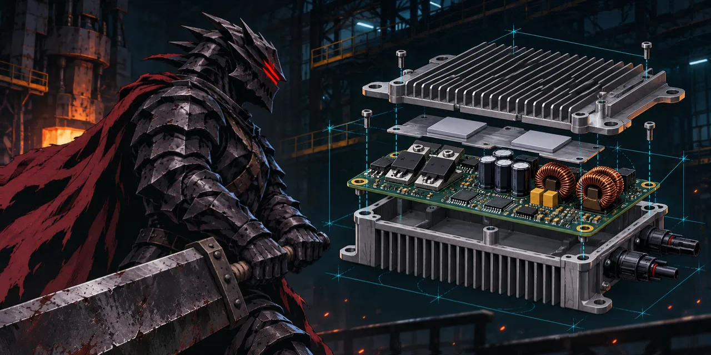

  <picture>
    <source media="(prefers-reduced-motion: reduce)" srcset="https://raw.githubusercontent.com/h3zus-m/h3zus-m/main/assets/hero-banner-static.webp">
    
  </picture>
   
  <a href="https://raw.githubusercontent.com/h3zus-m/h3zus-m/main/assets/hero-banner-static.webp">View still artwork</a>

<h1 align="center">Harsh Mistry</h1>

  <strong>NPI Sourcing · Supply Chain · Industrial Operations</strong> 
  USC Viterbi · M.S. Engineering Management, expected December 2026 
  PDEU · B.Tech. Mechanical Engineering, 2023

  
  
  
  

  
  
  
  
  

## Executive summary

I'm a mechanical engineer working across new product introduction (NPI), strategic sourcing, and manufacturing operations. At Generac Clean Energy, I reconciled engineering and costed bills of materials (BOMs and CBOMs), supplier quotes, and annual demand for **20+ priority microinverter components**. That work identified a **$1.2M annualized sourcing opportunity** and informed RFQ and negotiation priorities.

I also built a **Python Model Context Protocol (MCP) Decision Workbench** with four governed tools that trace recommendations to plant data. I'm seeking full-time roles in supply chain, global sourcing, technical program management, and industrial operations starting **January 2027**.

## Featured engineering systems

| Project | Outcome and methods |
| :--- | :--- |
| [Inside the Systems](https://h3zus-m.github.io/) | **10 chapters** with interactive case studies on clean-energy hardware, distribution, statutory testing, welding, and supply chain analytics. |
| [Generac Clean Energy · NPI sourcing](https://h3zus-m.github.io/#generac) · [3D microinverter demo](https://h3zus-m.github.io/D3p1oym3nt-W0rksp4c3/) | **$1.2M annualized sourcing opportunity identified.** Used Arena PLM, Excel, and PowerShell to reconcile part numbers, BOMs, supplier quotes, cost targets, and annual demand across 20+ components. |
| [AI Supply Chain Decision Workbench](https://h3zus-m.github.io/#workbench) | **4 governed tools across 12 simulated plants.** Built a Python MCP server for KPI segmentation, evidence retrieval, opportunity sizing, and recommendation generation. |
| [Inventory Policy Optimization](https://h3zus-m.github.io/#inventory) | **8-15% modeled reduction in total inventory cost.** Used R forecasting and Excel Solver to compare fixed order quantity, lot-for-lot, and periodic order quantity policies at target fill rates. |
| [Larsen & Toubro · Robotic seam monitoring](https://h3zus-m.github.io/#lt) | **20% improvement in defect detection and process reliability.** Integrated SolidWorks prototypes, electrical subsystems, and Python automation. Feasibility analysis showed a **10% projected cost reduction**. |

**More operations work:** [USC Bookstore distribution](https://h3zus-m.github.io/#usc) reached **>98% inventory accuracy across 1,000+ SKUs**. [Banco Products](https://h3zus-m.github.io/#banco) reduced **welding-related costs by 12%** through Kaizen and 5S. [Vindeep Expo Engineers](https://h3zus-m.github.io/#vindeep) coordinated multi-site statutory testing for pressure vessels and lifting equipment.

## Technical arsenal

**Industrial engineering & CAD** 
   
NPI procurement · BOM / CBOM management · RFQs · supplier evaluation · design for manufacturing

**Quantitative supply chain & analytics** 
    
Demand forecasting · inventory policy modeling · sensitivity analysis

**AI & software** 
    
Governed MCP tools · data reconciliation · automated validation · interactive web demos

**Quality & statutory compliance** 
   
Statutory testing · DFMEA · root cause analysis · SPC

## GitHub activity

  
  

  

