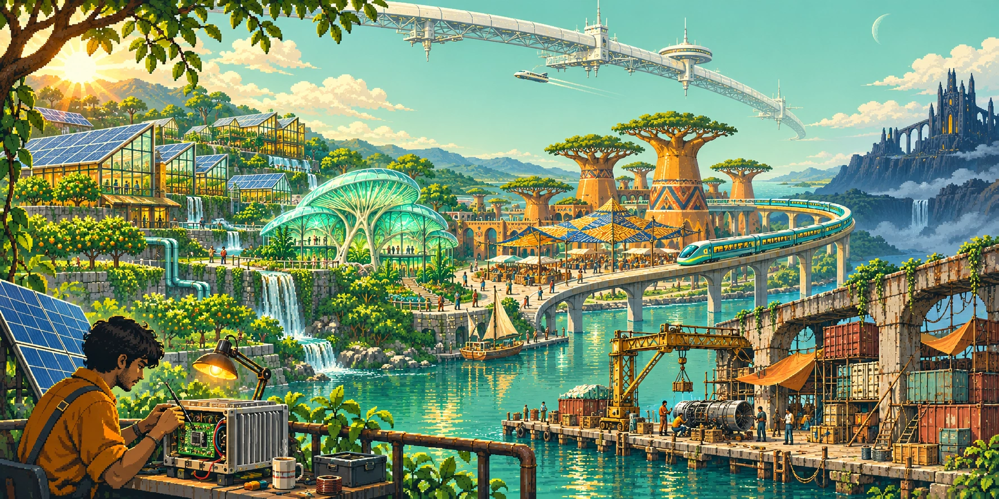

# Tideglass Harbor

The engineer at the open converter is the starting point for this fictional port. Follow the water from the glasshouses to the repair quay, then look up. The market, the keep, and even the terminal in the sky each have their own construction history.

| Where to look | What to look for | Video chapter |
| --- | --- | --- |
| **Solar terraces** · left bank | Blue photovoltaic panes share the greenhouse roofs with clear glass. A turquoise pipe runs beside the orchards and water spills from one planted level to the next. | [Solarpunk · 2:22](https://www.youtube.com/watch?v=BYTBZE67H50&t=142s) |
| **Living conservatory** · left of center | Look beneath the largest translucent cap. Branching ribs spread like mushroom gills, forming both the roof and its supports. People on the terrace give the shell its scale. | [Biopunk · 2:58](https://www.youtube.com/watch?v=BYTBZE67H50&t=178s) |
| **Market station** · center-right | The rail bends around broad, baobab-shaped towers. Below it, an indigo-and-gold woven canopy shades the market. The same geometry reappears as cladding on the towers. | [Afrofuturist · 7:29](https://www.youtube.com/watch?v=BYTBZE67H50&t=449s) |
| **Repair quay** · lower right | A broken viaduct still earns its keep. Cargo containers fit between its piers, a tarp shades the work floor, and a yellow gantry serves the water’s edge. | [Post-apocalyptic salvagecore · 3:33](https://www.youtube.com/watch?v=BYTBZE67H50&t=213s) |
| **Basalt keep** · far-right ridge | Tall pointed windows catch the last warm color on this side of the valley. Long stone buttresses tie the towers to the cliff above a bank of mist. | [Dark fantasy · 5:52](https://www.youtube.com/watch?v=BYTBZE67H50&t=352s) |
| **Orbital terminal** · overhead | The pale outer shell hides a deep, open truss. Look just below the terminal for a small shuttle. Its scale gives away how enormous the concourse is. | [Space-opera modernism · 5:16](https://www.youtube.com/watch?v=BYTBZE67H50&t=316s) |

The architectural reference is Sahari’s [*Fictional Architectural Styles Explained in 9 Minutes*](https://www.youtube.com/watch?v=BYTBZE67H50).

[Back to Harsh’s profile](https://github.com/h3zus-m)
