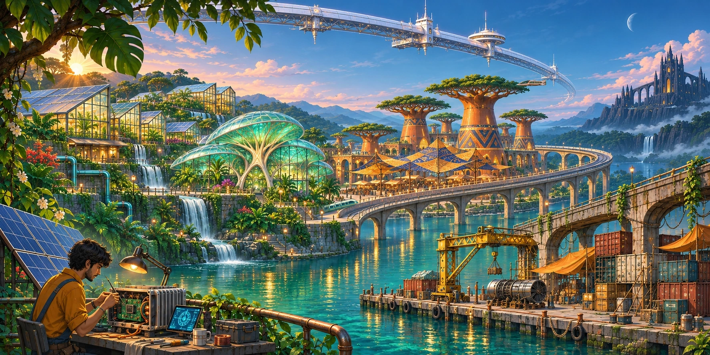

# Tideglass Harbor

The engineer at the open converter is the starting point for this fictional port. Follow the water from the glasshouses to the repair quay, then look up. The market, the keep, and even the terminal in the sky each have their own construction history.

| Where to look | What to look for | Architecture |
| --- | --- | --- |
| **Solar terraces** · left bank | Photovoltaic glasshouses, planted roofs, and cascading water form the harbor’s clean-energy district. | Solarpunk |
| **Living conservatory** · left of center | Branching ribs support translucent botanical shells above dense tropical planting. | Biopunk |
| **Market station** · center-right | Broad copper towers, indigo-and-gold geometric cladding, woven canopies, and an elevated railway. | Afrofuturism |
| **Repair quay** · lower right | Reused viaduct piers, cargo containers, canvas shelters, and an industrial gantry keep the waterfront working. | Post-apocalyptic salvagecore |
| **Basalt keep** · far-right ridge | Pointed windows and monumental buttresses rise from a mist-covered mountain. | Dark fantasy |
| **Orbital terminal** · overhead | A slender white concourse spans the sky over an exposed structural truss. | Space-opera modernism |

[Back to Harsh’s profile](https://github.com/h3zus-m)
